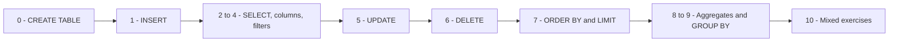

# Holberton School - Data Modeling and Persistence

SQL projects from Holberton School. The goal is to learn how to store data in a database and how to read and change it with SQL.

## Projects

| Folder | What is inside |
| --- | --- |
| [sql_crud](sql_crud/) | CRUD operations on a `books` table in SQLite (`my_database.db`) |
| [sql_join](sql_join/) | 15 queries that combine data from related tables |

## sql_crud

The `books` table:

| Column | Type |
| --- | --- |
| `id` | INTEGER, primary key |
| `title` | TEXT |
| `author` | TEXT |
| `genre` | TEXT |
| `price` | REAL |
| `stock` | INTEGER |
| `published_year` | INTEGER |

The files are numbered in the order of the lesson:



## sql_join

Queries that join tables, for example `1-books-with-authors.sql`, `3-students-and-courses.sql` and `15-instructors-with-active-courses.sql`.
Some of them also count rows or compare values with an average, like `7-course-enrollment-count.sql` and `6-courses-above-average.sql`.

## How to run

Run a SQL file on a SQLite database:

```bash
sqlite3 my_database.db < 2-select_all.sql
```

Or open the database and type queries:

```bash
sqlite3 my_database.db
```

## Concepts practiced

- Creating tables and choosing data types
- `INSERT`, `SELECT`, `UPDATE`, `DELETE`
- Filtering with `WHERE`, `AND`, `OR`
- Sorting and limiting results
- Aggregate functions: `COUNT`, `SUM`, `AVG`, `MIN`, `MAX`
- `GROUP BY`
- Joins between tables

## Author

Arif Almusharafi - [GitHub](https://github.com/arif-almusharafi)
